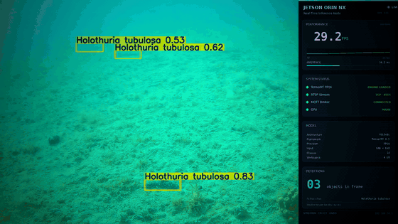
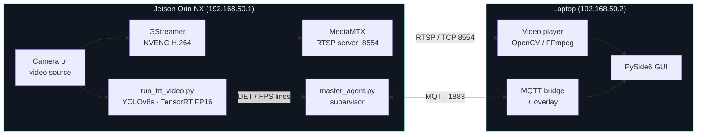
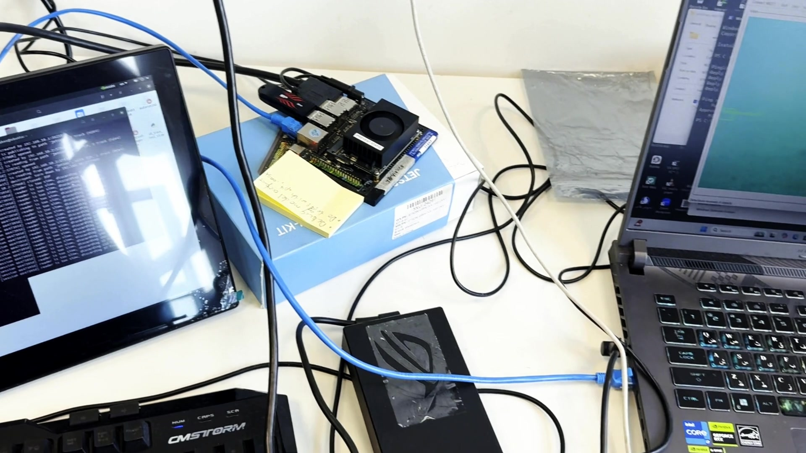
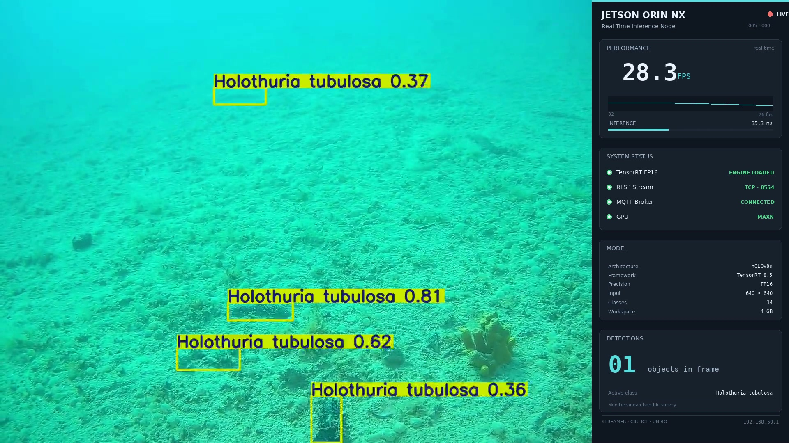
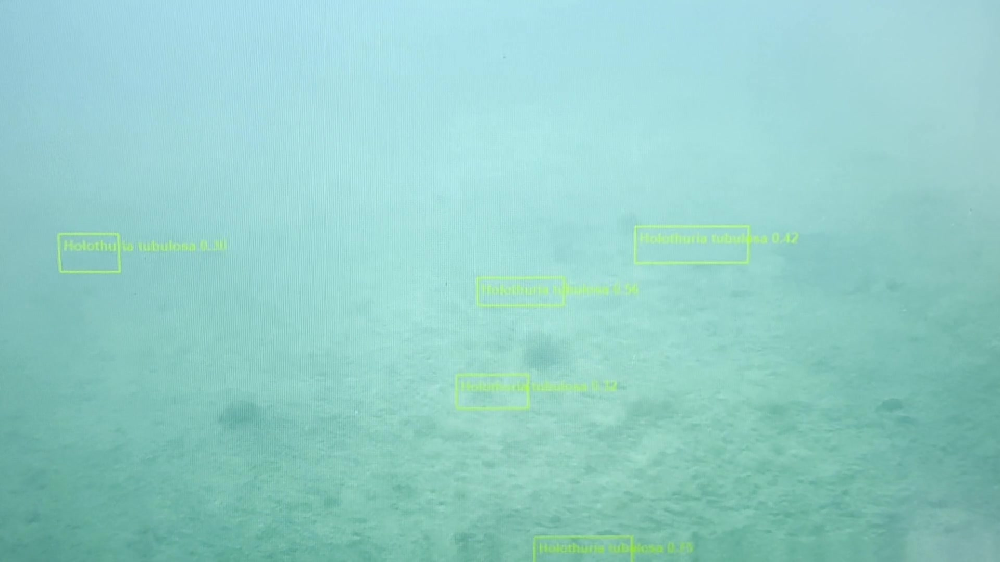

# Streamer Edge Perception

*Real-time underwater perception on NVIDIA Jetson Orin NX.*



An end-to-end perception pipeline developed during my time as a Research Fellow at the **University of Bologna (CIRI ICT, Forlì)**, within the **StreamER project**. A YOLOv8s detector compiled to a TensorRT FP16 engine runs on a Jetson Orin NX, with RTSP video and MQTT telemetry feeding a PySide6 operator GUI on a remote laptop. This repository captures what it took to make the system reliable enough to leave running in the field, not only what it took to make the model converge.

> This repository documents a real deployment. Running it requires the matching hardware. Reading it does not.

---

## Architecture

Three runtime planes, deliberately separated so they fail independently:



The **data plane** (RTSP video) and the **control plane** (MQTT telemetry and commands) are independent on purpose. Annotating frames on the Jetson and re-encoding them to RTSP would double the embedded CPU load; sending compact JSON detections over MQTT and overlaying them on the client is much cheaper. The trade-off is that detections are not strictly frame-synchronised; on a clean LAN, the visible drift is well under a video frame.

For a longer write-up, see [`docs/architecture.md`](docs/architecture.md).

## Pipeline

| Stage | Component | Role |
|---|---|---|
| Capture & encode | GStreamer (`nvv4l2h264enc`) | Hardware H.264 on Jetson, near-zero CPU cost |
| Transport | MediaMTX | Lightweight RTSP relay, TCP enforced for LAN reliability |
| Inference | YOLOv8s → ONNX → TensorRT FP16 | FP16 engine targeting the Orin NX compute capability |
| Control | paho-mqtt + Python supervisor | Start, stop, configure, retained status, JSON metadata |
| Display | PySide6 + OpenCV/FFmpeg | Two video backends (file and RTSP), live detection overlay |
| Networking | Direct Ethernet, static IPs | Removes institutional-network variables in field testing |

## Hardware setup



The deployment uses:

- **NVIDIA Jetson Orin NX** (16 GB) on a development carrier board, JetPack 5.x.
- A laptop running Windows 10/11 with Python 3.10–3.12 and a PySide6 GUI.
- A direct **Cat-6 Ethernet** link, no router, with static IPs (`192.168.50.1` and `.2`).
- An external 65 W barrel adapter for the Jetson, to avoid sustained-throughput throttling under inference + encode load.

## Demo

A short walkthrough showing the live detection footage with the scientific HUD, the physical hardware, and the operator GUI receiving the RTSP stream is included as [`media/demo.mp4`](media/demo.mp4) (~72 s, 1080p).

| Detection + HUD | Operator GUI on the laptop |
|---|---|
|  |  |

## Performance

Measured on Jetson Orin NX (16 GB) at Power Mode `MAXN`, JetPack 5.1.2,
TensorRT 8.5. GPU figures from `trtexec` on random input, single stream,
over a 10 s window after a 200 ms warm-up. End-to-end measured on 9240
source frames of 1440×1080.

| Input | GPU FPS | E2E FPS | GPU latency (mean) | GPU latency (p99) | Engine | mAP@0.5 | mAP@0.5:0.95 |
|---|---|---|---|---|---|---|---|
| 640×640 | 133 | 29.0 | 7.5 ms | 8.3 ms | 24.9 MB | 0.765 | 0.516 |
| 1280×1280 | 37 | 15.3 | 26.7 ms | 30.1 ms | 24.4 MB | 0.766 | 0.571 |

mAP figures are on a held-out test partition, disjoint from training at
source-frame level, over 519 instances in nine taxa at confidence 0.001
and NMS IoU 0.7. On the validation split the model reaches mAP@0.5 =
0.809 under the same configuration. The test partition was separated at
source-frame level because near-duplicate frames from the same clip
would otherwise appear on both sides of the split; the lower figure is
the one reported in the paper and the one to use for comparison.

End-to-end throughput is bound by the CPU-side video path, not by
inference. On a 2878×2160 source the pipeline falls to about 6 FPS at
both resolutions while GPU compute time is unchanged.

Board power was not instrumented and no power figure is reported.

The pipeline is stable under sustained load with a 65 W power supply.
With a 45 W supply the Jetson begins thermal and over-current throttling
within minutes; documented in [`docs/troubleshooting.md`](docs/troubleshooting.md).

An earlier version of this README reported 0.894 mAP@0.5 and a sustained
power figure. Both were withdrawn before the camera-ready paper and
should be disregarded.

## Setup

The repository is laid out so that one side of the system can be installed independently. See [`docs/deployment.md`](docs/deployment.md) for the full procedure.

### Jetson side (one-time)

```bash
# System packages not on a typical JetPack image
sudo apt update
sudo apt install -y mosquitto mosquitto-clients gstreamer1.0-tools

# MediaMTX (download the linux_arm64 release)
# https://github.com/bluenviron/mediamtx/releases
cp configs/mediamtx.example.yml ~/mediamtx.yml

# Python deps
pip3 install -r jetson/requirements.txt

# Edit your local config
cp configs/config.example.ini configs/config.ini
nano configs/config.ini    # set engine_dir and input_video paths
```

### Laptop side (one-time)

```powershell
python -m venv .venv
.\.venv\Scripts\Activate.ps1
pip install -r windows_app\requirements.txt
```

Configure the laptop's Ethernet adapter as static `192.168.50.2 / 255.255.255.0`, no gateway.

### Daily startup

```bash
# Jetson
scripts/check_network.sh   # read-only diagnostic
scripts/start_jetson.sh    # idempotent: brings up mosquitto, MediaMTX, GStreamer, agent
```

```powershell
# Laptop
.\scripts\start_windows_ui.ps1
```

In the GUI: **Connect MQTT** → **Play RTSP…** → **Start**.

## Repository layout

```
streamer-edge-perception/
├── README.md                  this file
├── LICENSE                    MIT
├── CITATION.cff               citation metadata
├── .gitignore
│
├── configs/
│   ├── config.example.ini     canonical configuration template
│   ├── config_loader.py       shared loader (configparser; stdlib only)
│   └── mediamtx.example.yml   MediaMTX reference config
│
├── jetson/
│   ├── master_agent.py        MQTT supervisor and process manager
│   ├── run_trt_video.py       TensorRT inference (PyAV decode, libx264 encode)
│   └── requirements.txt
│
├── windows_app/
│   ├── run_app.py             entry point
│   ├── requirements.txt
│   ├── app/
│   │   ├── main.py            PySide6 MainWindow + toolbar wiring
│   │   ├── mqtt_bridge.py     paho-mqtt on QThread
│   │   ├── video_player.py    QMediaPlayer + OpenCV-RTSP backend
│   │   └── ui_main_window.py  generated from .ui (regenerable)
│   └── ui/
│       └── main_window.ui     Qt Designer source
│
├── scripts/
│   ├── start_jetson.sh        idempotent orchestrator (network → broker → MTX → push → agent)
│   ├── stop_jetson.sh         reverse-order graceful shutdown
│   ├── check_network.sh       read-only pre-flight diagnostic
│   ├── start_windows_ui.ps1   GUI launcher
│   └── regenerate_ui.sh       wraps pyside6-uic
│
├── docs/
│   ├── architecture.md        three-plane design and rationale
│   ├── deployment.md          first-time setup and daily operation
│   ├── troubleshooting.md     symptom → cause → fix from real debugging
│   └── images/                README and docs assets
│
└── media/
    ├── demo.mp4               ~72-second walkthrough
    └── hero.gif               5-second loop used at top of README
```

## About this project

This work was developed while I was a Research Fellow at the University of Bologna, hosted at **CIRI ICT in Forlì**, contributing to the **StreamER project**. The objective was a perception system that could be deployed on embedded hardware in real conditions, not only demonstrated on a workstation.

Most of the engineering effort went into the parts that don't show up in a metrics table: stabilizing the RTSP session under varied network conditions, removing institutional-network variables with a direct Ethernet link, designing the MQTT control plane to be observable, and making the operator GUI behave when components fail.

Underwater imagery does not cooperate. Visibility shifts, color casts drift, particulate matter passes through the frame, and the signal-to-noise ratio is rarely what training data assumed. Building perception that holds up under those conditions, on hardware with a tight power budget, is the part of this work I want to keep doing.

If anything here is useful to your own work, I'd be glad to hear about it. Feedback and questions are welcome via Issues.

## What is intentionally not included

This is an engineering and architecture portfolio. To keep the repository focused and respect domain constraints:

- **No TensorRT engine files** (`*.engine`). They tie to a specific JetPack/TRT/GPU triple and are not portable.
- **No ONNX exports or PyTorch checkpoints**. Models can be re-derived from the published YOLOv8s recipe applied to your own dataset.
- **No training data**. The Mediterranean benthic imagery is not redistributable from this repository.
- **No annotated MP4 outputs** (the `runs_trt/` directory).
- **No internal project reports**. Those belong to the StreamER project, not to this engineering showcase.

## Citation

If you reference this work, see [`CITATION.cff`](CITATION.cff). Short form:

> H. Faraji, *Streamer Edge Perception: Real-Time Underwater Inference Pipeline on NVIDIA Jetson*, 2024. CIRI ICT, University of Bologna.

## License

MIT. See [`LICENSE`](LICENSE).
